# hex Exact, finished

hex Exact is finished when every tap, swipe and fold on the iPhone Duo does what you expect, at
once, on every screen, and the whole app has the care of Muse: hex in the middle, flat pages, dark
reading text, nothing on screen that hasn't earned its place.

The reference is Muse, not the stable hex voice app. `docs/parity.md` lists what that app does,
as an inventory to draw on.

## What finished means

1. **It works under the finger.** Every control answers the moment it's touched, says what it
   will do before you tap it, and never leaves you somewhere with no way back.
2. **One layout.** Every screen is laid out from the window's size and what the system covers
   (clock, battery, cameras, hinge, keyboard). No control or fixed part of ours ever sits under
   them, in any of the Duo's four poses, and the same size gives the same layout whether the
   phone is folded or not.
3. **hex is the home.** Its face, one live line of what it's doing, the few things that need
   you, what it's working on, what it decided. A call is one button away.
4. **One system.** One row, one section head, one answer row, one composer, one set of colours
   each with one job, in light and dark.
5. **The call holds.** It starts, reads, mutes, ends, reconnects and survives a locked screen.
6. **Seen on the Duo.** A piece is done when it's installed there and its flows have been seen
   there in every pose, light and dark. Ticked steps don't count.

## Where it is now

```
Home          built to the Muse design; reads well
              clock and battery sit on the Tasks/Settings capsule
              the update notice sits on hex's face
              open like a book: one list stretched across the whole width
past Home     no screen has been seen on iOS: a launch link leaves the app on Home in the
              simulator, and nothing can tap the Duo simulator yet
on the web    "hex decided" on Home opens Tasks at its top, not what hex decided
render        a decided row opens its topic's first open question, not itself
              Tasks during a call: the call's timer and End button draw over the list
              open like a book: threads, Steps, Calls and a past call are one page across
              the fold; the page beside Tasks runs over the search field
layout        each screen decides for itself, from the fold or a fixed number
              (`horizontalViewportSegments == 2` in 10 places; 520, 700, 900 in others)
Exact         pinned at 7722882 (Nov 12); upstream has moved a long way since
```

## Where it's going

Drawn from the app's own colours and type, at the Duo's real sizes. Source:
`docs/plan/drawings.html`. Folded on its side, where the camera and status icons sit is assumed
until Hands photographs that pose.

| | Folded | Open like a book |
|---|---|---|
| Home | 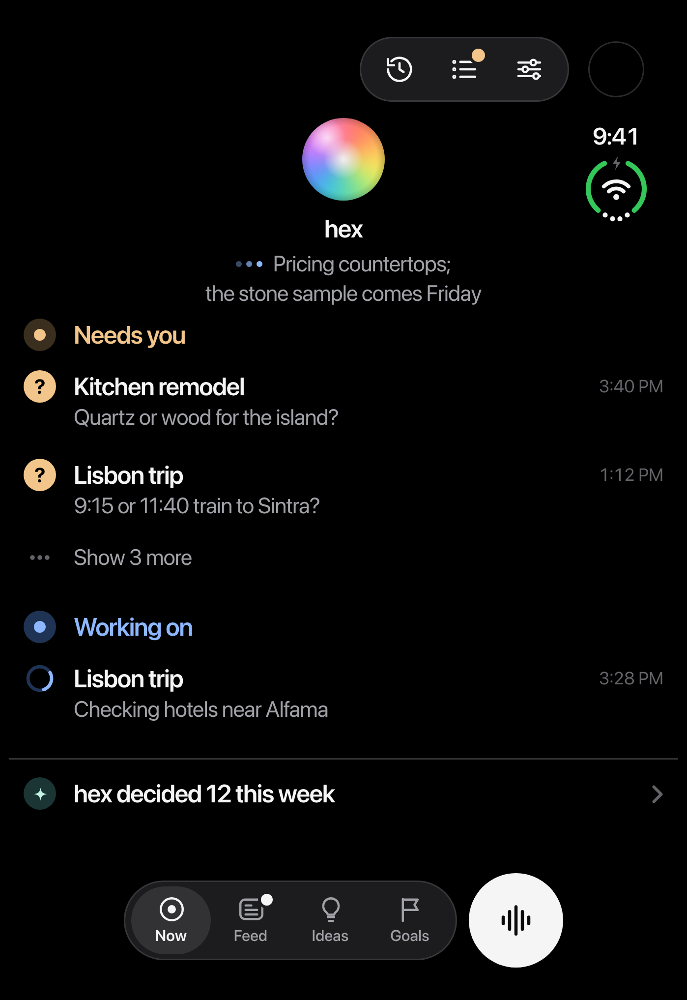 | 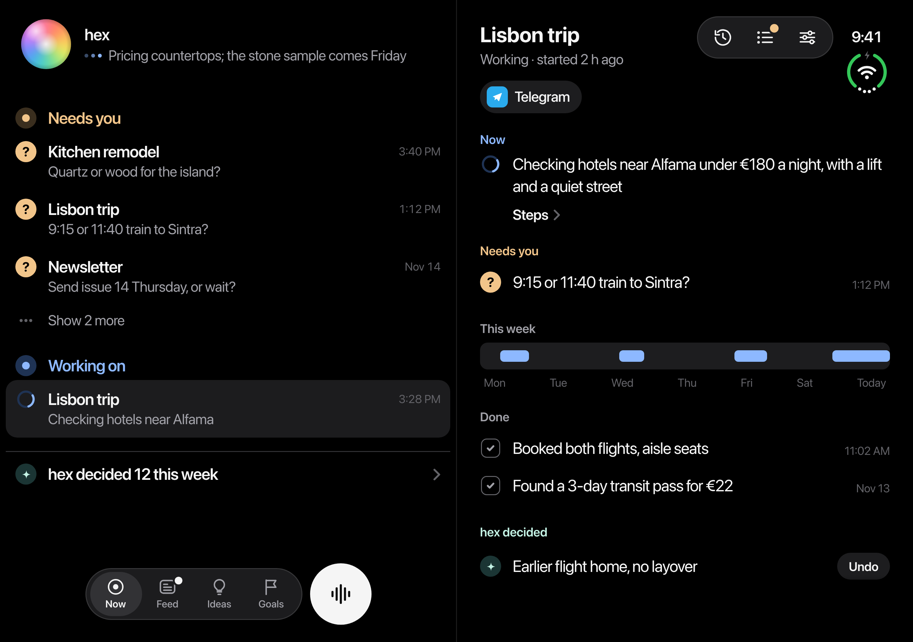 |
| A question | 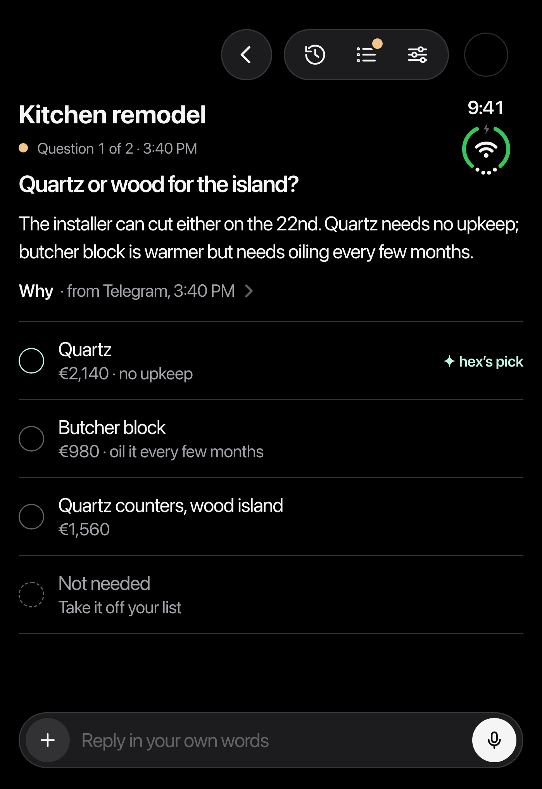 | 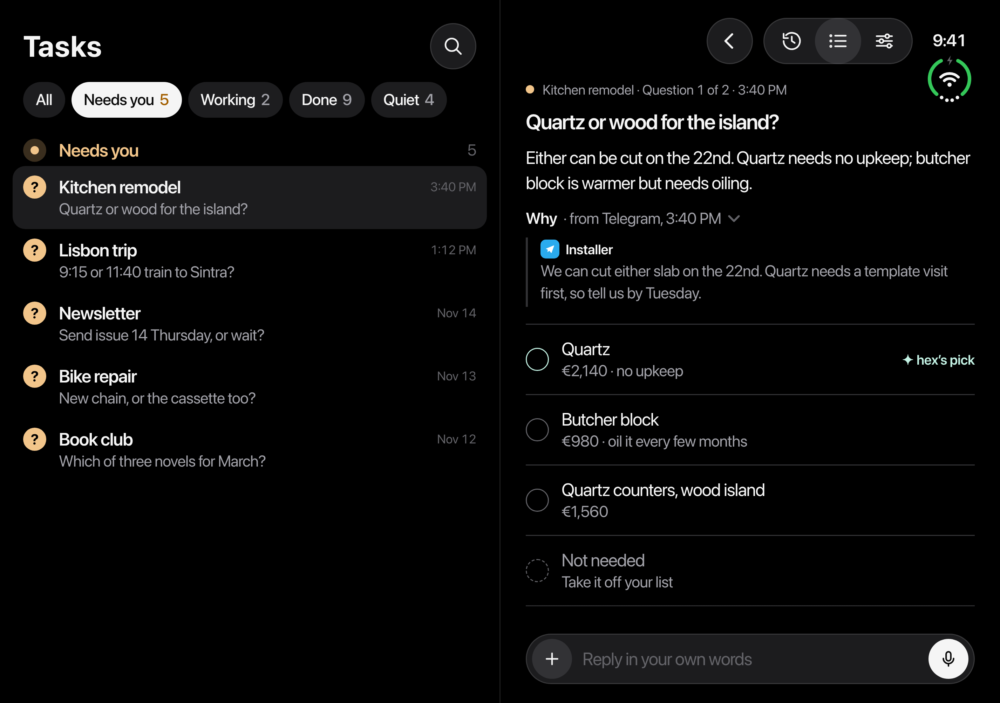 |
| A call | 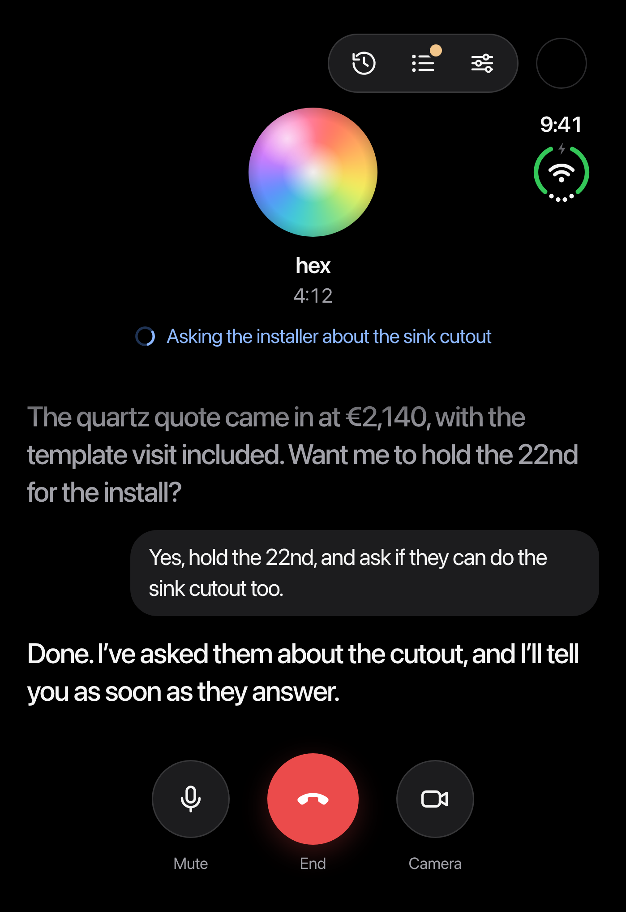 | 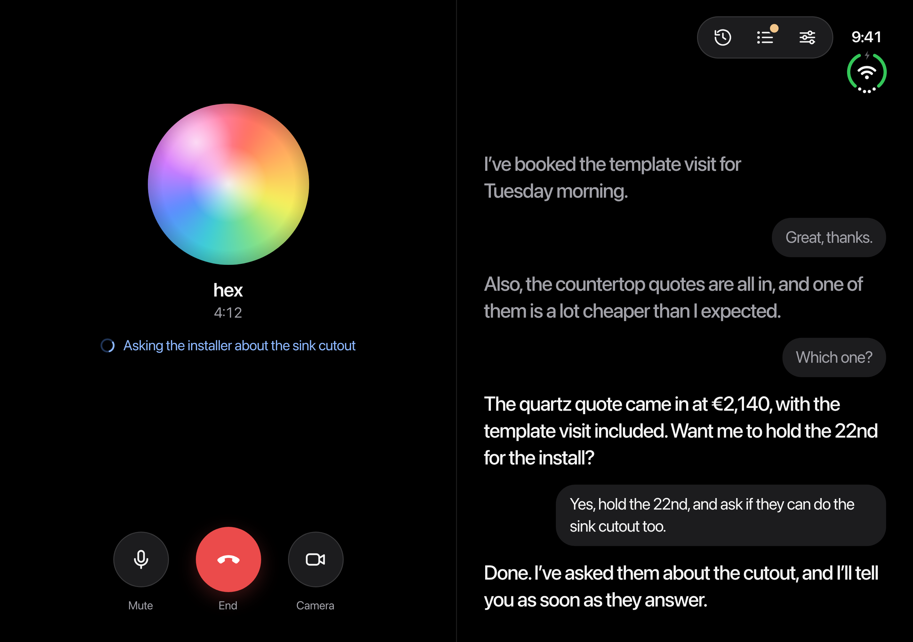 |
| Tasks | 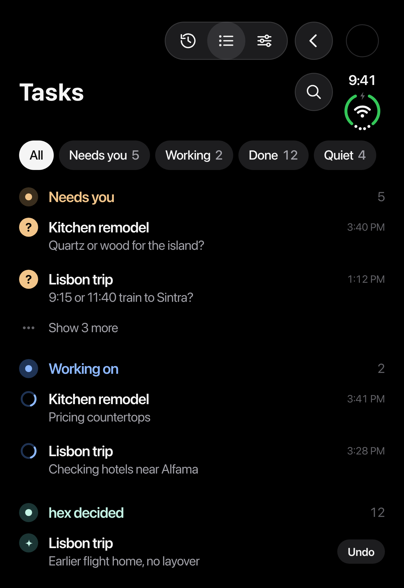 | 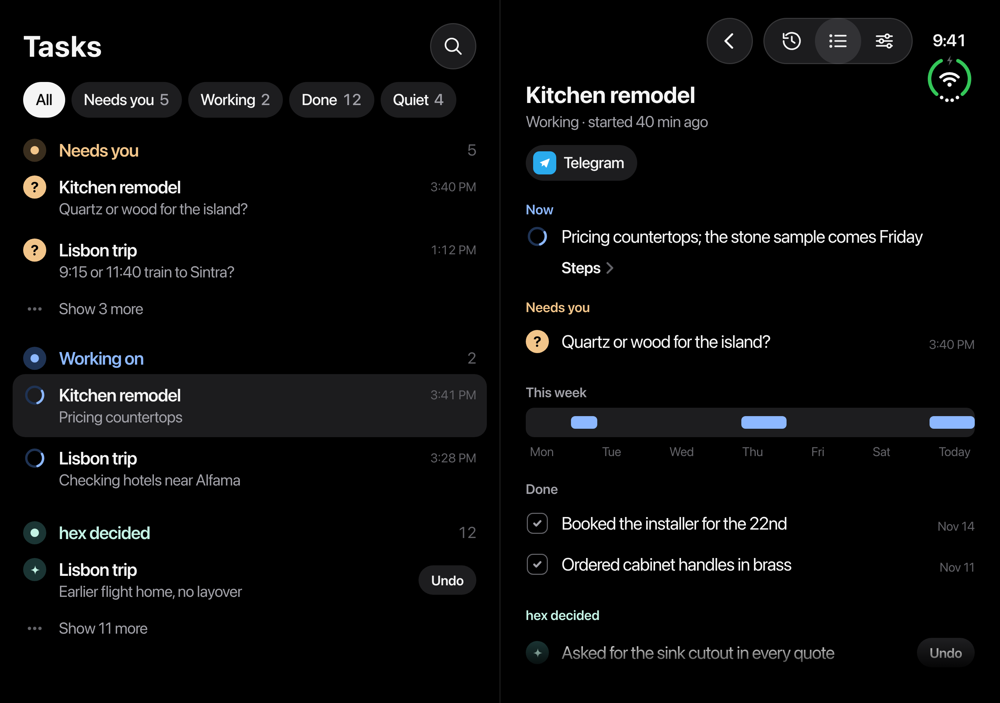 |

| | Folded on its side | Open like a laptop |
|---|---|---|
| Home | 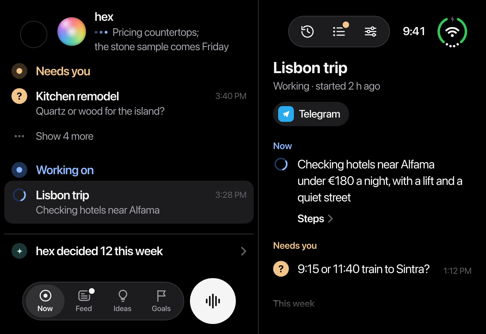 | 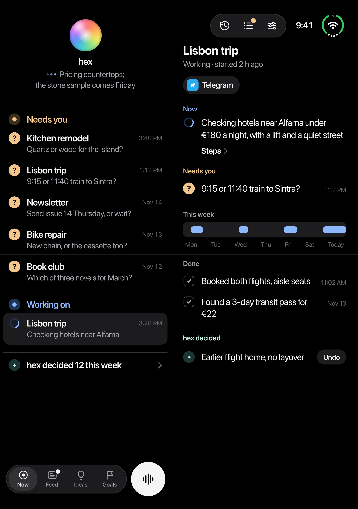 |

| An update waiting | Light |
|---|---|
| 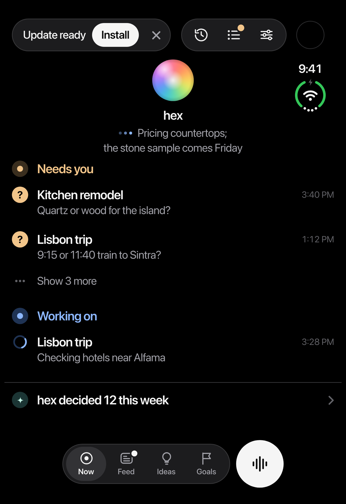 | 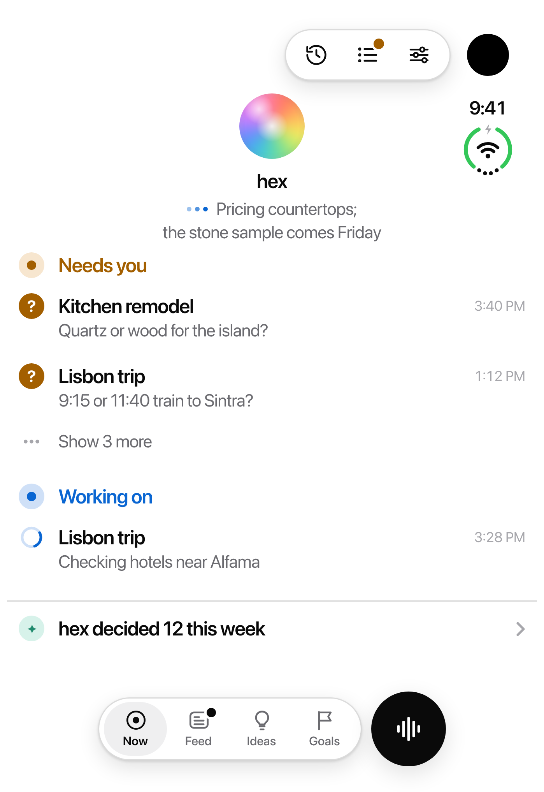 |

Light versions of Home and the question are in `docs/plan/`.

## The pieces

```
start together                         start when Room and System
                                       have their first commit
┌───────────────────────────────┐      ┌────────────────────────────────────┐
│ 1 Hands        scripts/       │      │ 5 Home and the call                │
│ 2 Room         one layout     │ ───▶ │ 6 Questions                        │ ───▶ 9 Last look
│ 3 System       one design     │      │ 7 Tasks and threads                │      on the Duo
│ 4 Call engine  shell/         │      │ 8 Calls, Settings and the update   │
└───────────────────────────────┘      └────────────────────────────────────┘
```

Each piece has one builder and owns its files; pieces 2, 3 and 5 to 8 each get a separate
reviewer.

| Piece | Owns |
|---|---|
| 1 Hands | `scripts/`, how `shell/Shell/App.swift` opens a link, `app/app.test.contract` |
| 2 Room | new `app/room.contract`, the layout lines of `app/app.contract`, `shell/Shell/Screen.swift`, where the toolbar, Back, the docked call and the update notice sit |
| 3 System | `app/parts.contract`, `app/shapes.contract`, `app/app.tamber` |
| 4 Call engine | `shell/**` (but `Screen.swift` and link opening), `app/modules/apple/Hex.swift`, `app/data/call.ts` |
| 5 Home and the call | `app/home.contract`, `app/call.contract` |
| 6 Questions | `app/ask.contract`, `pick.contract`, `picks.contract`, `last-check.contract`, `said.contract`, `media.contract`, `app/data/asks.ts` |
| 7 Tasks and threads | `app/tasks.contract`, `task.contract`, `thread.contract`, `steps.contract`, `inbox.contract`, `rows.contract`, `app/data/tasks.ts`, `kept.ts`, `pinned.ts`, `proof.ts`, `parse.ts` |
| 8 Calls, Settings, update | `app/calls.contract`, `past-call.contract`, `wrap-up.contract`, `settings.contract`, `voice.contract`, `words.contract`, what `toast.contract` says and does, `app/data/calls.ts`, `settings.ts` |

### 1 Hands

A builder can't finish what it can't touch. Today only Home has been seen on iOS.

Done when:
- `scripts/sim /tasks` shows Tasks: a launch link lands on its screen, in every pose.
- A flow (tap by `testId`, type, swipe, fold, rotate) runs on the Duo simulator and leaves a
  picture per step, per pose, light and dark. Example: Home, the first Needs you row, answer,
  Undo.
- The demo call runs inside a flow, so every in-call screen is reachable.
- A picture of the real Duo can be taken on request.
- Every line of "Where Exact can't" in `docs/build.md` is checked against Exact as it is today.
  Exact moves forward only if that lifts one of them and the app's tests still pass.

The stable app already drives the Duo simulator (`hex-voice/scripts/duo-taps`,
`uitests/`); start there.

### 2 Room

```
window size + what covers it (status icons, cameras, hinge, keyboard)
                         │
                         ▼
room (one place, the app's root)
  columns   one or two, by width; two only when both read well
  chrome    where Calls, Tasks, Settings and Back sit
  clear     the rectangle nothing covers
                         │
                         ▼
every screen takes `room`; none reads the fold or a width itself
```

Room's first commit is the shape and the frame a screen sits in, so the screen pieces can
start on it. It then moves Home, the toolbar, the docked call and the update notice onto it.
Each screen piece moves its own screens.

On the Duo, in all four poses:
- The clock, battery and cameras never touch a control or a word.
- Calls, Tasks, Settings, and Back on inner pages, sit beside the status icons. No page has a
  Back in its header.
- The update notice sits in Home's free toolbar space: never over hex, a control or the hinge.
- Calls, Tasks and Settings keep one place on every page. Back appears beside them without
  moving them.
- Call keeps a clear spot at the foot of hex's column, or the bottom corner when that column is
  full. No row sits under it.
- The same window size gives the same layout, folded or not. Two columns appear only when both
  read well. No control or fixed part sits on the hinge; a list may scroll across it.
- Fold, unfold, rotate: you stay on the page you were on, nothing jumps, the scroll holds.
- The keyboard comes up: the field stays in view and nothing else moves.
- In Split View, on an iPad and on a plain iPhone the same model lays the app out.

In code: `rg 'ViewportSegments|viewport\.(width|height) *[<>]' app/*.contract` finds only
`room.contract`.

### 3 System

On the Duo:
- Mint means one thing: hex's own choice, its pick and what it decided. Amber is a question,
  blue is work going on, red is a failure or ending the call.
- Home's rows and Tasks' rows are the same part. So are section heads, answer rows, composers,
  and the empty, loading and failed states. No screen draws its own.
- What you read is dark; grey is for side details. A live call's words are easy to read in dark
  and light.
- Light mode is as finished as dark: a card is visible on its background.
- Every control shows a press at once. Things that move share one spring, and stay still with
  Reduce Motion on.
- Larger text sizes fit without clipping.

### 4 Call engine

On the Duo:
- Tap Call: "connecting" shows at once and hex answers. Mute and End answer the tap, not the
  server.
- The call carries on with the screen locked or the app behind another.
- A drop reconnects by itself and says so. A phone call or Siri pauses it and it comes back.
- The Live Activity and Dynamic Island show the call; Mute and End work from them; it goes when
  the call does.
- "Call hex" from Siri uses the saved voice.
- The camera and Photos fill the window in every pose. The stable app's camera sheet laid
  itself out at iPhone width on the Duo; whatever caused that there is checked for here.
- Sounds and haptics follow their switches.
- The orb moves with your voice without a hitch while screens open over it.

### 5 Home and the call

On the Duo:
- Open the app: hex's face, its name, and one live line of two lines at most. A longer line
  ends in an ellipsis. A tap on the line opens that work.
- Needs you shows the few that fit without scrolling, then "Show N more". A tap opens that
  question: over Home when folded, beside it when there's room for two columns.
- Working on, then "hex decided N", which opens what hex decided.
- The last row never hides under the Call button.
- Call: one tap. The orb grows out of hex's face in one motion. Words are bright enough to
  read. Pulling the words up follows the finger.
- A question hex asks in the call shows at its moment and takes one tap to answer.
- Mute, End and the camera sit where a thumb reaches, and show only during a call.
- Open Tasks, Calls or Settings during a call: the call stays docked, and one tap returns.
- Hang up: Home shows how it ended and its wrap-up, and the call is in Calls at once.

### 6 Questions

On the Duo:
- A question opens on the question, in dark reading text, flat on the page.
- Every answer is the same kind of row; hex's pick is marked. One tap answers: the row
  confirms in place with Undo, and the list moves on without a jump.
- "Why" opens the whole background in one tap. Nothing opens in a second hidden step, and
  every control shows what a tap does.
- Your own words: a reply box docked above the keyboard. The keyboard stays up, the draft is
  kept if you leave, and + adds a photo.
- Pick several: check them, then Answer.
- hex decided is its own list. Each row opens to its full story: what hex picked, why, and
  what the other answers gave up. Undo puts it back in Needs you.
- "Not needed" is the last row of every question, and a swipe on its row in a list does the
  same. Both leave an Undo.
- A failure says why, under the thing that failed, with Try again.

### 7 Tasks and threads

On the Duo:
- Tasks opens at once with the last list it knew, then updates in place.
- Needs you, Working and Done read as sections; search finds across them; rows swipe.
- With room for two columns: the list on one side, the open row marked, its page beside it.
- A task's page says what it is, where it stands and what came last. "Open in Telegram" opens
  it, or says the app isn't on this phone.
- A thread shows its messages and photos. A send appears at once; a failed one retries with
  its photos; Stop stops the run. The keyboard stays up while you work.
- Steps tells a plan item, an agent and a step apart at a glance. A long result opens in place,
  with a chevron that says so.
- Tasks during a call leaves the call usable. If Exact still can't keep a sheet undimmed,
  Tasks is a page with the call docked, not a sheet over a dimmed call.

### 8 Calls, Settings and the update

On the Duo:
- Calls lists by day. A past call opens to its words, its wrap-up and the photos shared in
  it. A swipe removes one, with Undo.
- Settings is grouped, and each setting says what it does. A voice plays on a tap, silent
  switch or not. A new persona or colour shows on hex's face as you pick it.
- "Update ready · Install": one tap, an installing state, and the app reopens in the new
  build. During a call it says it will end the call. × hides it until the next build.
- A screens-only update arrives by itself while the app is in the background, never during a
  call or while you type.

### 9 Last look

Every flow, start to finish, on the real Duo in each pose, light and dark, against this page
and the drawings. What it finds goes back to the piece that owns it. hex Exact is called
finished after this, not before.

## Working in parallel

- Each builder works in its own git worktree, rebases onto main before every commit, and
  commits small, signed, straight to main.
- `app/app.contract` and `app/app.ts` are shared: Exact allows resources, mutations and actions
  only in the root. Room owns the layout lines. Every other piece adds the prop, resource or
  action its screens need and leaves the rest as it found it.
- A screen takes what it needs from Room and System. If either lacks something, their builder
  adds it; a screen doesn't work around it.
- The Mac builds one thing at a time (`mac.lock`). Iterate on the server with the web render
  (`bun exact.mjs agent web`); use the Mac for the pictures that prove a piece.
- Only main reaches the Duo. A screens-only change goes over the air (`scripts/publish`);
  anything in `app.ts`, `app/data/` or `shell/` needs `scripts/ship`. Both run from a clean
  checkout of main.
- A reviewer gets the piece's pictures (four poses, light and dark, each step of its flows),
  its "On the Duo" list, the drawings and Muse's screens. It reports what's wrong with the
  picture that shows it, and looks again after the fixes.

## Not in this plan

- Muse's Feed, Ideas, Goals and Spaces. This plan finishes what the app does today.
- Matching the stable app for its own sake.
